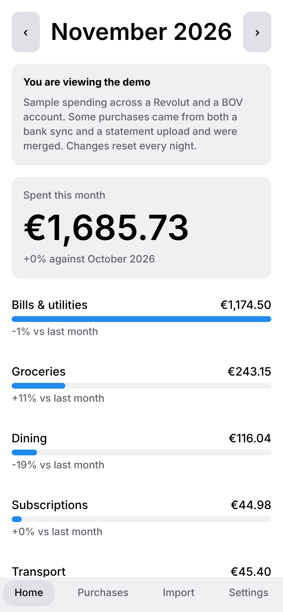
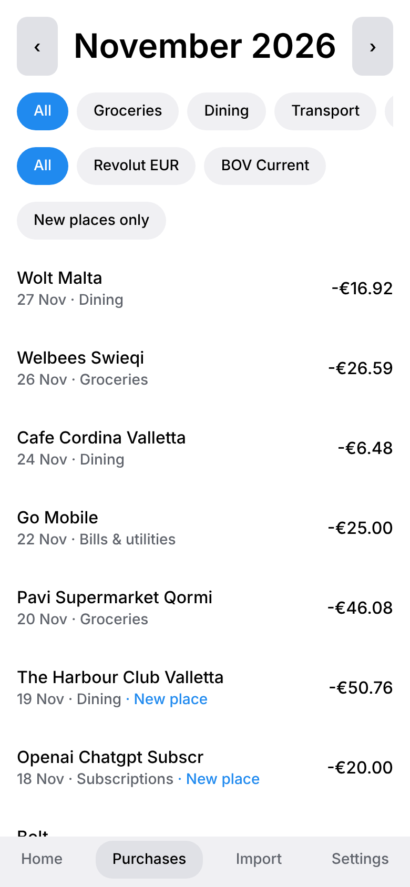
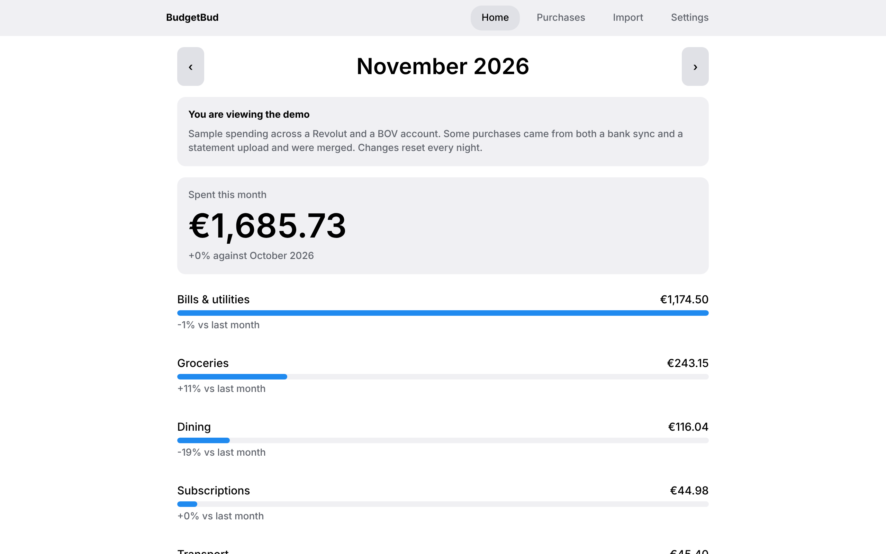
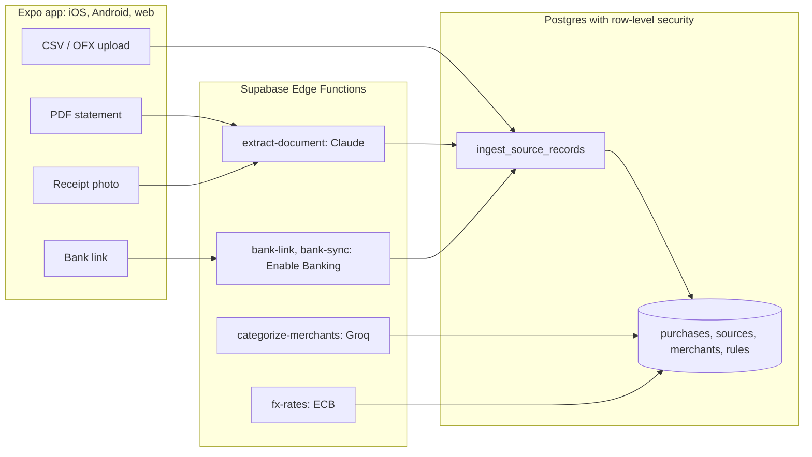

# BudgetBud

**See where your money goes, across every bank and card, without tracking anything by hand.**

BudgetBud pulls purchases from bank statements, open banking, PDF statements, and receipt photos into one list. It merges the same purchase when it arrives from two sources, sorts each one into a category, and shows monthly spending in euros on iPhone, Android, and the web.

**Live demo:** https://budgetbud-seven.vercel.app. Tap **Try the demo** on the sign-in screen to explore three months of sample spending. The demo resets every night.

| Dashboard | Purchases | Laptop |
|---|---|---|
|  |  |  |

## What it does

- **Imports from four sources.** CSV and OFX statements are parsed on the device. PDF statements and receipt photos are read by Claude. Bank accounts sync daily through Enable Banking, an EU open-banking provider.
- **Merges duplicates.** A card payment that arrives from the bank feed and again from an uploaded statement becomes one purchase that keeps both sources. A wrong merge can be split, and it never re-merges.
- **Sorts automatically.** Your own rules come first, then built-in rules for common Maltese and EU shops, then Groq for shops it doesn't know. Change a purchase's category once and future purchases from that shop follow.
- **Flags new places** the first time you buy somewhere.
- **Totals in euros.** Foreign-currency purchases keep their original amount and convert at the European Central Bank rate for their date. Transfers between your own accounts are left out.
- **Attaches receipts.** A receipt's items attach to the purchase it matches, now or when that purchase arrives later. A receipt never creates a purchase.
- **Respects your data.** Each user can only reach their own rows, enforced by the database. Users can delete their account and everything tied to it from inside the app.

## How it works

Every import path hands normalized records to one Postgres function, `ingest_source_records`. Keeping the merge rule in one place means the four paths can't drift apart. A record merges into an existing purchase when it has the same account, amount, and currency, a date within 3 days, a similar merchant name (trigram similarity of at least 0.4), and came through a different channel.

## Tech choices

| Area | Choice | Why |
|---|---|---|
| App | Expo SDK 58, Expo Router, TypeScript strict | One codebase for iOS, Android, and the web |
| Backend | Supabase in the EU: Postgres, Auth, Storage, Edge Functions | Row-level security keeps each user's data private at the database |
| Money | Integer cents with an ISO currency code | No floating-point errors in equal-amount matching |
| Bank sync | Enable Banking behind one provider interface | Free for personal use in the EU, and swappable later |
| AI sorting | Groq, in batches of 50 merchant names | Fast and cheap. Only merchant names leave the database, and each merchant is sorted once |
| Document reading | Claude Sonnet 5.5 with structured outputs | Reliable line extraction from PDFs and photos |
| Hosting | Vercel for the web build | Static export, no server to run |

Secrets such as AI keys, the bank provider's private key, and the database admin key live only in Edge Function secrets. The app never calls an outside service directly.

## Tests

| Suite | Command | Covers |
|---|---|---|
| App | `npm test` | Parsers, money, import flow, auth guard, screens |
| Database | `npm run test:db` | RLS isolation, merging, splitting, sorting, spending totals, receipts, demo data |
| Edge Functions | `npm run test:functions` | Groq sorting, document extraction, bank linking and sync, account deletion, exchange rates |

The database tests are written in pgTAP. `scripts/db-test/run.sh` runs them on a local Postgres with a small Supabase stand-in, for machines where the Supabase CLI's Docker images aren't available.

## Run it yourself

1. Install dependencies: `npm install`
2. Create a Supabase project and apply the migrations in `supabase/migrations/` in order.
3. Copy `.env.example` to `.env` and fill in your project URL and publishable key.
4. Start the app: `npx expo start`, then press `w` for the web.
5. Optional features need Edge Function secrets: `GROQ_API_KEY` for AI sorting, `ANTHROPIC_API_KEY` for PDFs and receipts, and `ENABLE_BANKING_APPLICATION_ID` with `ENABLE_BANKING_PRIVATE_KEY` for bank sync.

The full design, with requirements, key decisions, and implementation units, is in [docs/plans](docs/plans/).
