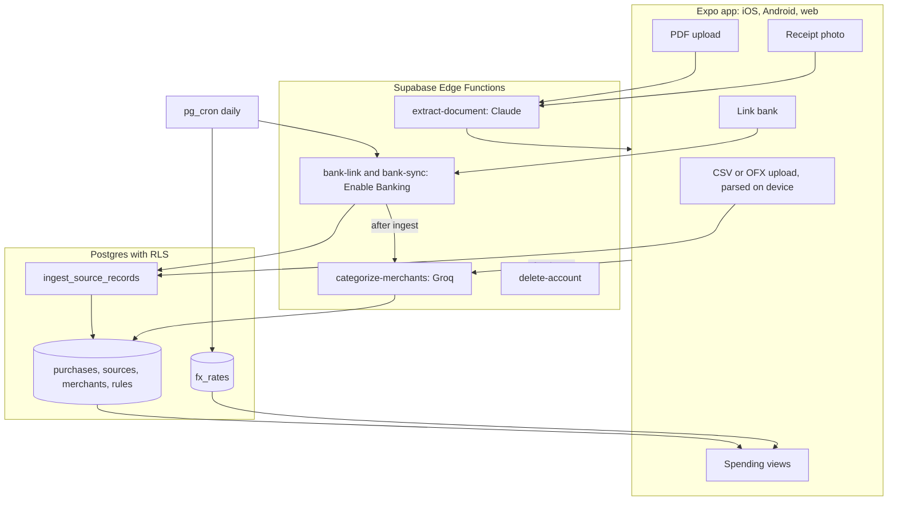
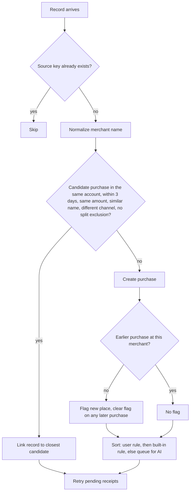
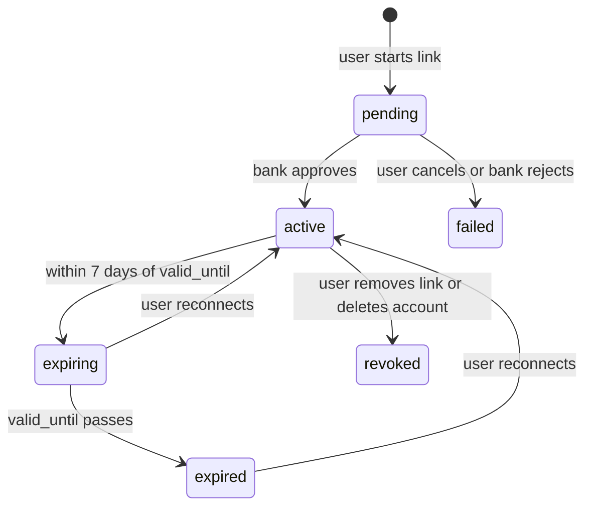
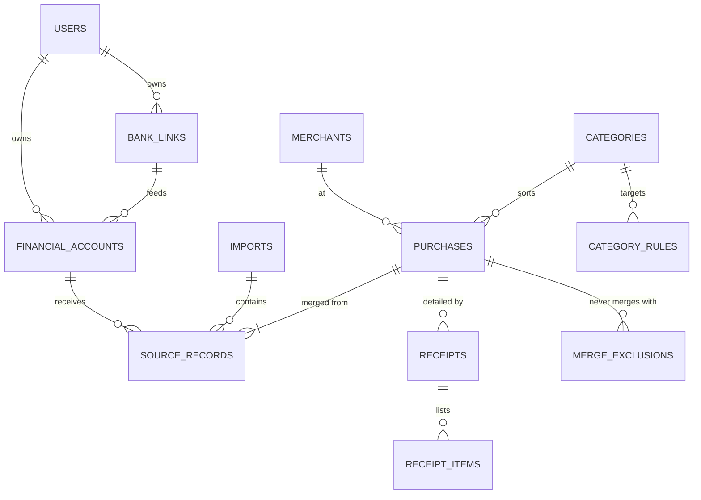

# BudgetBud Core Loop - Plan

## Goal Capsule

- **Objective:** The owner, who lives in Malta and banks in the EU, can see where their money goes by category and by place, on their phone and laptop, without tracking spending by hand. The same app can later be sold on the App Store and Google Play without a rebuild.
- **Means:** One Expo app for iOS, Android, and web, backed by an EU-region Supabase project. Purchases arrive from four import paths, merge into one list in the database, and get sorted into categories (KTD1, KTD3).
- **Product authority:** The repository owner decides product behavior and scope. The Product Contract below governs product behavior, and the Planning Contract governs mechanism within it. Budgeting advice, emailed receipts, Apple FinanceKit, and store submission are not active scope.
- **Execution profile:** One pull request on the session branch. Build the units in Unit Index order. U11 and U12 need the owner's Enable Banking account, U8 needs an Anthropic API key, and U5's AI sorting needs a Groq API key, so build those parts once the accounts exist.
- **Stop conditions:** Stop and ask the owner when a unit would change product behavior in the Product Contract, when an outside service's real behavior contradicts a KTD (for example, Enable Banking rejects the application's signed requests, or an account whitelisted in its control panel still returns no data), or when a credential or account the plan needs does not exist yet.
- **Who finishes:** `ce-work` builds and verifies each unit. The owner creates the outside accounts listed under Dependencies, sets the secrets, and reviews and merges the pull request.
- **Open blockers:** None for planning. U5's AI sorting, U8, U11, and U12 wait on the owner's accounts and keys.

---

## Product Contract

Product Contract preservation: changed, R7 and R18 kept their wording while the bank-sync provider moved from Teller to Enable Banking for the owner's EU banks; added R20 to R22 for transfers, foreign currency, and bank-link expiry, all confirmed in the plan's scoping summary; Outstanding Questions resolved in place by KTD5, KTD6, KTD7, and KTD13.

### Summary

Build the BudgetBud foundation as an Expo app on an EU-region Supabase project. Statement files, AI-read PDFs and receipts, and Enable Banking sync all feed one ingest step in the database, which merges duplicates, sorts purchases, and flags new places. Spending views show totals in euros, leaving out transfers, on phone, tablet, and laptop browser.

### Problem Frame

The owner wants to know where their money goes but has no single place that pulls their spending together. Bank apps show one account each, and sorting purchases by hand is the kind of chore that stops after a few weeks.

The owner may also sell the app later. A personal tool that stores data on one device, or a web page in a store wrapper, would need a rebuild at that point. Apple can reject apps that are mostly a website in a wrapper. Once other people sign up, the app holds strangers' bank data, so per-user data separation and account deletion are expensive to add after launch.

### Key Decisions

- **Expo with Supabase for everything.** One codebase covers iPhone, Android, and the laptop through the web build, and Supabase provides the database, sign-in, storage, and server functions. (session-settled: user-directed, chosen over a custom backend server and over a local-first synced database: fewest moving parts for a solo builder, and the local-first sync risks mixing up financial data.) Governs R1, R2.
- **Data lives in the cloud with user accounts.** (session-settled: user-directed, chosen over device-only storage: phone and laptop stay in sync, at the cost of securing every user's financial data.) Governs R2, R3, R4.
- **Four import paths in the first version.** Statement files, AI-read PDF statements, automatic bank sync, and receipt photos. (session-settled: user-directed, chosen over starting with statement files only: the owner wants every source available from the start.) Governs R5, R6, R7, R8.
- **Forwarded email receipts are out.** (session-settled: user-directed, chosen over keeping them as a fifth path: the app does not need an inbox.)
- **Duplicates merge automatically, with undo.** (session-settled: user-directed, chosen over confirming each suspected duplicate and over one source per account: manual confirmation gets tedious, and one source per account cannot fill gaps.) Governs R9, R10, R11.
- **Enable Banking for bank sync.** It is a licensed EU provider using the banks' official PSD2 APIs, it is free for personal use of the owner's own accounts, and it covers Revolut and HSBC Malta. (session-settled: user-directed, chosen over Teller, which has no bank agreements and covers no EU banks, and over Plaid, which offers only sales-negotiated plans in Europe.) Governs R7, R22.
- **Free tiers first, paid services when the app is sold.** Supabase's free tier, Enable Banking's personal-use tier, and a free open-model API for sorting merchants. (session-settled: user-approved, chosen over paid services from day one: the owner is the only user for now.) Governs R7, R13.
- **Claude reads PDFs and receipt photos, through an API key on the server.** Accuracy matters most for these jobs, and the owner's Claude subscription cannot be used by an app. The model is Claude Sonnet 5.5. (session-settled: user-approved, chosen over an open model for every AI job: open models misread messy statements and receipts more often.) Governs R6, R8, R18, R19.
- **Euros are the home currency, and data stays in an EU region.** The owner lives in Malta. (session-settled: user-approved, chosen over a single-currency, US-region setup: Revolut holds several currencies, and EU hosting keeps stored data in Europe.) Governs R16, R21.
- **Transfers and card payments are not spending.** (session-settled: user-approved, chosen over counting every outflow: paying a card from a current account would otherwise count the same money twice.) Governs R20.
- **Advice stays on budgeting, never investments.** Recommending investments, securities, or other financial products can trigger investment-adviser rules. Applies to the later advice work, recorded here so nothing in this plan crosses the line.

<!-- ce-section: work-relationships -->
### How This Work Fits Together

This plan covers the core loop: bring purchases in, merge them, sort them, and show them. The breakdown below is the current understanding, not a committed roadmap.

- **Budgeting advice:** suggestions based on the user's sorted spending.
  - Depends on this plan's sorted purchase history, ideally a few months of it.
  - Still to decide: what advice looks like, how often it appears, and which model writes it.
- **Selling the app:** store listings, subscriptions, a GDPR-compliant privacy policy, and a commercial bank-data agreement.
  - Depends on this plan's account separation (R3) and account deletion (R4).
  - Shares the bank-provider interface (KTD8) with a move to a paid provider.
- **Apple FinanceKit:** Apple Card, Apple Cash, and Apple Savings data on iPhone.
  - Can proceed independently of advice. Apple's FinanceKit has launched in the US only, so it may not apply to the owner.

### Requirements

**Accounts and platform**

- R1. One app runs on iPhone, Android, and the web, and the web build works on a laptop browser.
- R2. A user signs in and sees the same purchases, categories, and rules on every device they use.
- R3. A user can see, change, and delete only their own data, enforced by the database rather than the app.
- R4. A user can delete their account from inside the app, which removes their purchases, uploaded files, bank links, and sign-in.

**Bringing purchases in**

- R5. A user can upload CSV and OFX statement files, and each row becomes a purchase.
- R6. A user can upload a PDF statement, and the extracted purchases appear for review so the user can fix a misread line before saving.
- R7. A user can link a bank account, and new purchases arrive automatically without uploads.
- R8. A user can photograph a receipt, and its item details attach to the matching purchase. A receipt never creates a purchase.
- R22. The app warns the user before a bank link expires and lets them reconnect it.

**Merging duplicates**

- R9. When the same purchase arrives from more than one source, the app keeps one purchase, matching on equal amount, a date within a few days, and a similar merchant name.
- R10. A user can split a wrong merge, and later imports never merge that pair again.
- R11. Importing the same file or syncing the same date range twice creates no new purchases.
- R12. Every purchase keeps a record of which sources it came from.

**Sorting and new places**

- R13. Every purchase gets a category, from the user's own rules first, then built-in merchant rules, then an AI model for merchants the rules do not know.
- R14. When a user changes a purchase's category, the app applies that choice to future purchases from the same merchant.
- R15. A purchase from a merchant with no earlier purchase in the user's history is flagged as a new place, and the user can dismiss the flag.

**Seeing where money goes**

- R16. A user sees total spending by category for a month and can compare it with earlier months.
- R17. A user can browse purchases and filter them by category, account, month, and new places.
- R20. Spending totals leave out the Transfers & payments category, and the user can move a purchase into or out of it.
- R21. A purchase in another currency keeps its original amount and counts toward euro totals at the European Central Bank reference rate for its date.

**Security and cost**

- R18. AI keys, bank-provider credentials, and the database's admin key exist only on the server, never in the app.
- R19. Each user's AI usage is recorded, so the cost per user stays visible.

### Key Flows

- F1. First setup
  - **Trigger:** The owner installs the app or opens the web build for the first time.
  - **Steps:** Create an account; link a bank account or upload a statement; purchases appear, merged and sorted, with new places flagged.
  - **Outcome:** A first month of spending shows by category in euros.
  - **Covered by:** R2, R5, R7, R9, R13, R15, R16
- F2. PDF statement import
  - **Trigger:** The user uploads a PDF statement.
  - **Steps:** The server reads the PDF; extracted purchases appear for review; the user fixes any misread line and saves; saved purchases merge with existing ones and get sorted.
  - **Outcome:** The statement's purchases join the list without duplicates.
  - **Covered by:** R6, R9, R11, R13
- F3. Receipt photo
  - **Trigger:** The user photographs a receipt.
  - **Steps:** The server reads the receipt; the app finds the matching purchase; the item details attach to it.
  - **Outcome:** The purchase shows what was bought.
  - **Covered by:** R8, R9
- F4. Bank link renewal
  - **Trigger:** A bank link is within 7 days of expiry.
  - **Steps:** The app shows a warning on the dashboard; the user taps reconnect and approves at the bank; syncing resumes.
  - **Outcome:** No gap in synced purchases.
  - **Covered by:** R7, R22

### Acceptance Examples

- AE1. Covers R9, R12.
  - **Given:** A €42.17 purchase at "LIDL MT 1234 QORMI" arrived through bank sync on March 3.
  - **When:** The user uploads a CSV with a €42.17 purchase at "Lidl" dated March 4.
  - **Then:** The list shows one purchase, and it lists both sources.
- AE2. Covers R10.
  - **Given:** The app merged two real €5.00 coffee purchases from the same café on the same day, one from a CSV and one from bank sync.
  - **When:** The user splits them, then re-uploads the same statement.
  - **Then:** Both purchases stay separate.
- AE3. Covers R8.
  - **Given:** No purchase matches a new receipt photo yet.
  - **When:** The matching purchase arrives through bank sync two days later.
  - **Then:** The receipt's item details attach to it, and no extra purchase was ever created.
- AE4. Covers R14.
  - **Given:** The app sorted a purchase at "Joe's Market" as Dining.
  - **When:** The user changes it to Groceries.
  - **Then:** The next purchase at Joe's Market is sorted as Groceries without an AI call.
- AE5. Covers R15.
  - **Given:** The user has six months of purchases, none at "Café Cordina".
  - **When:** A Café Cordina purchase arrives.
  - **Then:** It is flagged as a new place. A second Café Cordina purchase the next week is not.
- AE6. Covers R6.
  - **Given:** A PDF statement where the AI misreads €18.40 as €184.00.
  - **When:** The user corrects the amount during review and saves.
  - **Then:** The saved purchase shows €18.40.
- AE7. Covers R20.
  - **Given:** A €600 payment from the current account to the Revolut card, and €600 of card purchases that month.
  - **When:** The user opens that month's totals.
  - **Then:** Spending shows €600, not €1,200.
- AE8. Covers R21.
  - **Given:** A £20.00 Revolut purchase on a date when the ECB rate is 0.85 pounds per euro.
  - **When:** The user views the month's totals.
  - **Then:** The purchase shows £20.00 and adds €23.53 to the totals.

### Success Criteria

- The owner imports a month of their own statements, sees spending by category on both phone and laptop, and gets flagged when they spend somewhere new.
- Running the app for one user costs close to €0 a month, with AI usage in the range of cents.

### Scope Boundaries

**Deferred for later**

- Budgeting advice, as its own brainstorm.
- Forwarded email receipts.
- Apple FinanceKit for Apple Card, Apple Cash, and Apple Savings.
- A paid bank-data agreement, needed once the app has users other than the owner.
- Offline use with a full copy of the data on each device.
- Subscriptions, store listings, a GDPR-compliant privacy policy, vendor data-processing agreements, and the legal review needed before charging anyone.

**Outside this product's identity**

- Moving money, paying bills, or lending. BudgetBud only reads spending.
- Investment, securities, loan, or insurance recommendations.

**Deferred to Follow-Up Work**

- Submitting builds to the App Store and Google Play. This plan stops at installable test builds.
- Google, Apple, or magic-link sign-in.
- Instant bank updates through provider webhooks. Daily sync plus a manual sync covers R7 for now.
- Re-sorting a merchant's past purchases when the user changes a category. R14 covers future purchases only.

**Considered and not built**

- Encrypting stored purchases at the application level on top of Supabase's encryption at rest. Row Level Security plus server-only keys covers R3 and R18. A security review before selling could change this call.
- Per-user daily caps on AI calls. Sign-ups stay off while the owner is the only user (KTD17), so no one else can spend the AI budget. Opening sign-ups before selling would change this call.
- A queue for AI jobs. Extraction is user-triggered and sorting is batched, so volume stays far below free-tier limits. Rate-limit errors in the usage log would change this call.

### Dependencies / Assumptions

- The owner creates four accounts: a Supabase project in an EU region, an Enable Banking application in restricted production mode with their bank accounts linked in its control panel, a Groq API key, and an Anthropic API key with a monthly spending limit set.
- The owner's banks include Revolut, which syncs through Enable Banking. Other Maltese banks, such as Bank of Valletta, APS, and BNF, are not supported by Enable Banking and come in through statement uploads.
- Each bank the owner uses offers CSV, OFX, or PDF statements. Revolut exports Excel, which the owner saves as CSV, or PDF.
- How long a bank link stays valid is set by each bank under PSD2, commonly 90 or 180 days.
- Claude and Groq are US services. Statement contents and merchant names leave the EU when they are read. That is acceptable for the owner's personal use and gets a GDPR review before selling.

### Sources / Research

- `.claude/skills/budgetbud/SKILL.md`: the project's standing rules, updated by U1 for Enable Banking, the EU region, and euros.
- `.claude/skills/expo-overview/SKILL.md`, `.claude/skills/expo-project-structure/SKILL.md`, `.claude/skills/supabase/SKILL.md`, and `.claude/skills/supabase-postgres-best-practices/SKILL.md`: load before building.
- Expo SDK 58 docs: `create-expo-app --template default@sdk-58` includes Expo Router and TypeScript. Values prefixed `EXPO_PUBLIC_` are inlined into the bundle and readable by users.
- Supabase docs: Row Level Security policies written as `(select auth.uid()) = user_id` with `to authenticated`, and an index on the filtered column. Edge Functions use `withSupabase` from `npm:@supabase/server`, with `auth: 'user'` for user calls and `auth: 'secret'` for scheduled jobs. The Expo quickstart's `LargeSecureStore` keeps sessions encrypted on device.
- Enable Banking terms and docs: production use is free for private individuals' own linked accounts. Malta coverage includes HSBC Malta and excludes APS, BNF, Bank of Valletta, Lombard, FCM, and Izola. Revolut is reachable through its PSD2 API.
- Plaid support docs: customers based in Europe get custom plans only.
- Apple App Store Review Guidelines 5.1.1(v) requires in-app account deletion for apps with account creation. Guideline 4.8 requires Sign in with Apple when an app offers other third-party sign-in.
- The `claude-api` skill: current model IDs, PDF and image content blocks, structured outputs through `output_config.format`, and server-side refusal fallbacks.

---

## Planning Contract

### Key Technical Decisions

- KTD1. **Expo SDK 58 with Expo Router, TypeScript strict mode, and a development build.** The default template gives file-based routes across iOS, Android, and web. Native modules for the camera and secure storage need a development build rather than Expo Go. Implements R1, R2.
- KTD2. **Supabase in an EU region, with all schema in versioned migrations under `supabase/migrations/`.** Local development runs through the Supabase CLI, and production changes go out only as migrations. Implements R3, R21.
- KTD3. **One database function owns ingest, merging, rule sorting, and new-place flags.** Every import path, including the app and Edge Functions, hands normalized records to `ingest_source_records`. It takes the owner from the financial account and import it is given. A signed-in caller must be that owner, and only the service role may ingest for another user, which is how the scheduled sync calls it. Keeping the merge rule in one place stops the four paths from drifting apart. Implements R9, R11, R12, R13, R15.
- KTD4. **Money is stored as integer minor units with an ISO currency code.** Outflows are negative. Totals add only outflows outside the Transfers & payments category, converted to euros. Floating-point amounts would break the equal-amount match in R9. Implements R16, R20, R21.
- KTD5. **The duplicate match is equal amount and currency, booking dates within 3 days, and a merchant similarity of at least 0.4.** Similarity uses `pg_trgm` on normalized names, or one normalized name containing the other. A candidate purchase qualifies only if it belongs to the same financial account, none of its sources came through the same channel, meaning the same bank account feed or the same uploaded file, and no split exclusion names the pair. When several qualify, the closest date wins. Implements R9, R10. Resolves the origin question on the match window.
- KTD6. **Each source record has a deterministic source key, unique per user.** Bank records use the provider's transaction ID when the bank returns one. When it does not, the key is built the way a file row's is. File rows hash the account, date, amount, description, and the row's occurrence count among identical rows in that file, so two real identical coffees in one statement stay two records. A record whose key already exists is skipped. Implements R11.
- KTD7. **Merchant names are normalized in SQL before matching.** Lowercase, strip accents, and remove card-processor noise such as store numbers, dates, country codes, and prefixes like "CRV*" or "SumUp *". It lives next to the merge logic as one function, so matching and new-place flags read the same name. Implements R9, R15.
- KTD8. **Bank sync sits behind one provider interface in Edge Functions, with Enable Banking as the only implementation.** Linking, listing accounts, fetching transactions, and expiry handling go through that interface. A later paid provider replaces one module. Implements R7, R22.
- KTD9. **Enable Banking calls are signed on the server with the application's private key.** Each request carries a short-lived RS256 token built with Web Crypto in the Edge Function. The key lives in Edge Function secrets, and session IDs live in a `private` schema that the API does not expose. Edge Functions reach it only through security-definer functions that only the service role may execute. Implements R7, R18.
- KTD10. **Bank sync runs daily through `pg_cron`, plus a "Sync now" action.** The cron job reads the function URL and secret key from Supabase Vault at run time, so no secret sits in a migration. It then calls the sync function, which syncs each active link from its last booked date minus 7 days, so late-posting transactions are caught and KTD6 drops repeats. Implements R7, R11.
- KTD11. **Groq sorts unknown merchants, in batches of up to 50 names per call, through its OpenAI-compatible chat API with a JSON schema response.** Only merchant names and the category list are sent. Each answer is saved as an AI-origin rule owned by that user, so a merchant costs one call per user. The sorter is a shared module that both the app-triggered function and the daily sync run after ingest. Each run picks up all of the user's merchants still Uncategorized, so a Groq failure is retried on the next run. The exact Groq model is chosen at build time from Groq's current list. Implements R13, R19.
- KTD12. **Claude Sonnet 5.5 extracts PDFs and receipts through the Anthropic SDK in one Edge Function, with structured outputs and server-side refusal fallbacks.** PDFs go in as document blocks of at most 5 pages per call, sliced with pdf-lib, so each call finishes inside the Edge Function time limit. Receipts go in as image blocks. Responses stream to avoid request timeouts. Every call writes token counts to `ai_usage`. Implements R6, R8, R18, R19.
- KTD13. **ECB reference rates are fetched daily and stored in a shared `fx_rates` table.** A purchase on a day with no rate, such as a weekend, uses the latest earlier rate. The euro amount is computed when totals are read, so a rate correction applies everywhere. The first run loads the ECB's full historical rate file, so imported past statements convert too. A purchase with no rate on or before its date is left out of totals and counted as unconverted, and the dashboard shows that count. Implements R21.
- KTD14. **CSV and OFX files are parsed in the app.** The first upload for an account asks which columns hold the date, amount, and description, along with the date format, and saves that mapping on the account. Parsing on device gives an instant preview before anything is saved. Implements R5. Resolves the origin question on statement formats.
- KTD15. **Built-in categories and rules ship as seed data.** The list is Groceries, Dining, Transport, Shopping, Bills & utilities, Health, Entertainment, Travel, Subscriptions, Cash, Fees, Income, Transfers & payments, and Uncategorized. Built-in rules cover common Maltese and EU merchants and transfer phrases such as Revolut top-ups and card payments. Implements R13, R20. Resolves the origin question on the category list.
- KTD16. **Charts use a library that renders on iOS, Android, and web, chosen at build time.** Victory Native and react-native-gifted-charts are the starting candidates. The month view has a month switcher and a category bar list showing the change against the previous month. Implements R16. Resolves the origin question on chart types, with the library left to U7.
- KTD17. **Sign-in is email and password through Supabase Auth, with email confirmation.** Sessions persist through the `LargeSecureStore` pattern on iOS and Android and through browser storage on the web. Implements R2. Adding Google or Apple sign-in would trigger Apple's Sign in with Apple requirement. While the owner is the only user, new sign-ups are turned off in Supabase Auth once the owner's account exists, so no stranger can spend the owner's AI quota.
- KTD18. **Account deletion runs in an Edge Function.** It revokes each bank session with Enable Banking, removes the user's storage files, and deletes the auth user. Foreign keys with `on delete cascade` remove every row. Implements R4.
- KTD19. **Unmatched receipts stay pending and retry on every ingest until they match.** The user can also link a pending receipt by hand at any time. Statement uploads are often monthly, so a time cutoff would drop receipts before their purchase arrives. Implements R8. Resolves the origin question on receipts that never match.

### High-Level Technical Design

Purchases flow from four sources into one ingest function. Everything to the right of the app runs on the server.



The PDF path returns extracted lines to the app for review before they reach ingest (R6). The receipt path writes a receipt record that ingest matches to a purchase (R8).

Ingest handles each record in this order:



A bank link moves through these states:



The core tables relate like this:



### Output Structure

The tree shows the expected shape. Per-unit file lists are authoritative, and the `expo-project-structure` skill may adjust app folder names.

```text
src/
  app/                      Expo Router screens
    (auth)/                 sign-in, sign-up
    (tabs)/                 dashboard, purchases, import, settings
    purchase/[id].tsx       purchase detail
  lib/                      supabase client, money, dates, parsers
  components/
supabase/
  config.toml
  migrations/               schema, RLS, functions, seed
  tests/                    pgTAP database tests
  functions/
    _shared/                bank provider interface, Enable Banking client, AI clients
    extract-document/
    bank-link/
    bank-sync/
    categorize-merchants/
    fx-rates/
    delete-account/
```

### Sequencing

U1 to U4 lay the foundation, and every later unit depends on them. U5 to U7 make the app useful with statement files alone, so the owner sees real data before the bank and Anthropic accounts exist. Only U5's AI sorting needs a key, the Groq key, and merchants stay Uncategorized until it is set. U8 to U10 add AI extraction. U11 and U12 add bank sync once the Enable Banking account exists. U13 and U14 finish deletion and builds.

### Risks

| Risk | Effect | Mitigation |
|---|---|---|
| Enable Banking's restricted mode returns no data for an account the owner did not whitelist in its control panel | Bank sync shows no accounts for that bank | U11 starts with a smoke test and shows a whitelisting message when a link returns no accounts. Statement upload covers any gap. |
| A bank link expires unnoticed | Purchases stop arriving | R22 warning on the dashboard, plus a sync failure notice in settings |
| A long PDF exceeds the Edge Function time limit | Extraction fails | Extract at most 5 pages per call (KTD12), which keeps each call under the limit. Reject files over 50 pages. |
| Card purchases post more than 3 days after the date a statement shows | A duplicate purchase double-counts spending | U6 verification compares the owner's real CSV against synced Revolut data, and the window in KTD5 is tuned if real duplicates fall outside it |
| Enable Banking or a bank accepts only HTTPS redirect URLs | The native app cannot receive the bank's redirect | U11's smoke test checks this. If so, the web callback receives the redirect and deep-links into the app. |
| The Supabase CLI needs Docker, which a cloud session may lack | Database tests cannot run locally | Run migrations and pgTAP tests against a Supabase branch database instead |
| Merchant similarity merges two different shops with equal amounts on close dates | A wrong merge | R10 split, and the same-channel rule in KTD5 blocks the most common case |
| Groq changes its free limits or models | Sorting stops for new merchants | Purchases stay Uncategorized and retry. The model name is configuration, not code. |

### Alternatives Considered

- **Merging in each import path's own code.** Rejected for KTD3. Four copies of the merge rule would drift, and AE1 to AE3 depend on identical behavior across paths.
- **Parsing statement files in an Edge Function.** Rejected for KTD14. Column mapping needs the user to see the file's columns, so parsing on device saves a round trip and keeps raw files off the server.
- **Converting foreign currency at import time.** Rejected for KTD13. Storing the original amount and converting at read time keeps R21's original amount exact and lets rate corrections apply everywhere.

---

## Implementation Units

| U-ID | Title | Files touched | Depends on |
|---|---|---|---|
| U1 | App scaffold and tooling | `package.json`, `app.json`, `src/app/_layout.tsx`, `.claude/skills/budgetbud/SKILL.md` | none |
| U2 | Database schema and access rules | `supabase/migrations/*_core_schema.sql`, `supabase/tests/rls.test.sql` | U1 |
| U3 | Sign-in and sessions | `src/lib/supabase.ts`, `src/app/(auth)/*` | U1, U2 |
| U4 | Ingest, merge, and split | `supabase/migrations/*_ingest.sql`, `supabase/tests/ingest.test.sql` | U2 |
| U5 | Sorting and new places | `supabase/migrations/*_sorting.sql`, `supabase/functions/_shared/categorize.ts`, `supabase/functions/categorize-merchants/*` | U4 |
| U6 | Statement file import | `src/lib/parsers/*`, `src/app/(tabs)/import/*` | U3, U4 |
| U7 | Spending views and exchange rates | `src/app/(tabs)/index.tsx`, `src/app/(tabs)/purchases.tsx`, `src/app/purchase/[id].tsx`, `supabase/functions/fx-rates/*` | U5, U6 |
| U8 | Document extraction function | `supabase/functions/extract-document/*` | U2 |
| U9 | PDF statement review | `src/app/(tabs)/import/pdf-review.tsx` | U6, U8 |
| U10 | Receipt capture and matching | `src/app/receipt/*`, `supabase/migrations/*_receipts.sql` | U4, U8 |
| U11 | Bank linking | `supabase/functions/bank-link/*`, `supabase/functions/_shared/bank/*`, `src/app/(tabs)/settings/banks.tsx`, `src/app/(tabs)/index.tsx` | U3, U4, U7 |
| U12 | Daily bank sync | `supabase/functions/bank-sync/*`, `supabase/migrations/*_bank_sync_cron.sql` | U5, U11 |
| U13 | Account deletion | `supabase/functions/delete-account/*`, `src/app/(tabs)/settings/account.tsx` | U3, U11 |
| U14 | Web and device builds | `eas.json`, `app.json` | U7, U13 |

### U1. App scaffold and tooling

**Goal:** A running Expo app on iOS, Android, and web, with the project's tooling and updated project rules.

**Requirements:** R1. KTD1.

**Dependencies:** None.

**Files:**
- Create the project with the SDK 58 default template: `package.json`, `app.json`, `tsconfig.json`, `src/app/_layout.tsx`
- `.env.example` listing only `EXPO_PUBLIC_SUPABASE_URL` and `EXPO_PUBLIC_SUPABASE_PUBLISHABLE_KEY`
- `jest.config.js` with the `jest-expo` preset, and `src/lib/__tests__/smoke.test.ts`
- Modify `.claude/skills/budgetbud/SKILL.md`: replace Teller and Plaid with Enable Banking under KTD8 and KTD9, and add the EU region, euros, and the 3-day merge window
- Modify `.gitignore` for `.env`, `node_modules/`, and Expo build output

**Approach:**
1. Scaffold at the repository root without overwriting `.claude/`, `.compound-engineering/`, `docs/`, or `README.md`.
2. Turn on TypeScript strict mode and set the app scheme `budgetbud` for deep links.
3. Follow `expo-overview` and `expo-project-structure` for folder layout.

**Patterns to follow:** The `expo-overview` setup rules.

**Test expectation:** none -- scaffolding. A smoke test proves Jest runs.

**Verification:** The app starts on web and in a development build, type checks pass, and the updated project skill names Enable Banking.

### U2. Database schema and access rules

**Goal:** Every table the core loop needs, locked so each user reaches only their own rows.

**Requirements:** R3, R12, R18, R20, R21. KTD2, KTD4, KTD15.

**Dependencies:** U1.

**Files:**
- `supabase/config.toml`
- `supabase/migrations/<timestamp>_core_schema.sql`: `profiles`, `financial_accounts`, `bank_links`, `imports`, `source_records`, `purchases`, `merchants`, `categories`, `category_rules`, `merge_exclusions`, `receipts`, `receipt_items`, `ai_usage`, `fx_rates`, and the `private.bank_sessions` table
- `supabase/migrations/<timestamp>_seed_categories.sql`: built-in categories and rules per KTD15
- `supabase/migrations/<timestamp>_storage.sql`: private `statements` and `receipts` buckets with per-user folder policies
- `supabase/tests/rls.test.sql`

**Approach:**
1. Give every user table a `user_id` referencing `auth.users` with `on delete cascade`, a btree index on it, Row Level Security enabled, and `(select auth.uid()) = user_id` policies for `authenticated`.
2. Make built-in categories and rules readable by all signed-in users and writable by none. Their `user_id` is null.
3. Make `fx_rates` readable by signed-in users and writable only by the service role.
4. Keep the `private` schema out of the exposed API schemas. Add security-definer functions in `public` to put, get, and delete a bank session ID, revoke execute from `public`, `anon`, and `authenticated`, and grant it only to `service_role`. U11, U12, and U13 reach session IDs only through these functions.
5. Enable the `pg_trgm` and `unaccent` extensions.
6. Store amounts as `bigint` minor units with a three-letter currency column, per KTD4.

**Patterns to follow:** `supabase-postgres-best-practices` for types, indexes, and RLS tests.

**Test scenarios:**
- User A reads purchases and receives none of user B's rows.
- User A tries to update user B's purchase by ID, and zero rows change.
- User A tries to insert a purchase carrying user B's `user_id`, and the insert is rejected.
- A signed-in user reads built-in categories, and an attempt to edit one is rejected.
- A signed-in user cannot select from `private.bank_sessions` through the API, and cannot execute the bank session functions.
- The service role can store, read, and delete a bank session ID through the bank session functions.
- User A cannot read or list files under user B's storage folder.
- Deleting a test auth user removes that user's rows from every table.

Seam: these pgTAP tests catch policy gaps at the database, where R3 is enforced. They do not exercise the app's own queries.

**Verification:** Migrations apply cleanly to an empty database, and every RLS test passes.

### U3. Sign-in and sessions

**Goal:** A user can create an account, sign in, stay signed in across launches, and sign out.

**Requirements:** R2. KTD17.

**Dependencies:** U1, U2.

**Files:**
- `src/lib/supabase.ts`: the client, with `LargeSecureStore` on native and browser storage on web, plus the foreground auto-refresh listener
- `src/app/(auth)/sign-in.tsx`, `src/app/(auth)/sign-up.tsx`
- `src/app/_layout.tsx`: route guard sending signed-out users to sign-in
- `src/lib/__tests__/auth-guard.test.tsx`

**Approach:**
1. Follow the Supabase Expo quickstart for the client and session storage.
2. Require email confirmation, and show a "check your email" state after sign-up.
3. Create the user's `profiles` row with `home_currency` set to `EUR` on first sign-in.

**Patterns to follow:** The Supabase React Native quickstart client in the Sources.

**Test scenarios:**
- A signed-out user opening the dashboard route is sent to sign-in.
- A signed-in user opening sign-in is sent to the dashboard.
- Sign-up with an already-registered email shows an error and creates no second account.
- A wrong password shows an error and keeps the user signed out.
- Signing out clears the stored session, and reopening the app lands on sign-in.

**Verification:** The owner can sign up, confirm by email, close and reopen the app, and still be signed in on web and a development build.

### U4. Ingest, merge, and split

**Goal:** One database function turns incoming records into merged purchases, and a user can split a wrong merge.

**Requirements:** R9, R10, R11, R12, R15. KTD3, KTD5, KTD6, KTD7. Covers F1, F2, AE1, AE2, AE5.

**Dependencies:** U2.

**Files:**
- `supabase/migrations/<timestamp>_ingest.sql`: `normalize_merchant`, `ingest_source_records`, and `split_source_record`
- `supabase/tests/ingest.test.sql`

**Approach:**
1. `ingest_source_records` takes an import ID and a JSON array of normalized records, and returns counts of created, merged, and skipped records. It writes every row under the owner of the import and its financial account, per KTD3. It rejects a signed-in caller who is not that owner, and only the service role may call it for another user.
2. Follow the ingest order in the High-Level Technical Design.
3. Treat the channel for KTD5 as the bank-linked account for bank records and the import for file and PDF records.
4. Keep each merchant's first purchase date as the earliest booking date among its purchases. Flag the earliest purchase as the new place. When ingest adds an earlier purchase, move the flag to it and clear it on the later one, unless the user already dismissed it.
5. `split_source_record` moves one source record to a new purchase, records a merge exclusion for that pair, and recomputes both purchases' dates and merchants from their remaining sources.

**Execution note:** Implement test-first. The merge rule is the core of the product and easy to get subtly wrong.

**Technical design:** Directional only. The candidate search filters by user, amount, currency, and date range first, then ranks by name similarity, then by date distance.

**Test scenarios:**
- Covers AE1. A bank record for "LIDL MT 1234 QORMI" at −€42.17 on March 3, then a file record for "Lidl" at −€42.17 on March 4, produce one purchase with two sources.
- A file record 4 days after a matching bank record creates a second purchase.
- Two identical −€5.00 café records in one file create two purchases, because they share a channel.
- Importing the same file records twice creates nothing the second time and reports them as skipped.
- Covers AE2. After a split, re-ingesting the same file record leaves both purchases separate.
- Records with equal amounts in different currencies never merge.
- Equal-amount records at the same café on consecutive days from two different financial accounts never merge.
- Covers AE5. The first purchase at a merchant is flagged as a new place, and a second purchase there is not.
- Ingesting a March 20 purchase and then a March 2 purchase at the same merchant leaves only the March 2 purchase flagged.
- A service-role call ingesting for a user's account writes every row under that account's owner.
- A merchant name with only noise, such as "POS 0000", still normalizes to a non-empty name.
- `normalize_merchant` maps "SumUp *Café Cordina", "CAFE CORDINA VALLETTA", and "Café Cordina" to names with similarity of at least 0.4.
- A signed-in user ingesting records into another user's import or account is rejected.

Seam: database tests catch merge logic at its single owner. They miss how each import path builds records, which U6, U9, and U12 test.

**Verification:** Every ingest test passes, and ingest results include the created, merged, and skipped counts.

### U5. Sorting and new places

**Goal:** Every purchase gets a category, unknown merchants are sorted by AI once, and a user's correction sticks for that merchant.

**Requirements:** R13, R14, R15, R19, R20. KTD11, KTD15. Covers AE4, AE7.

**Dependencies:** U4.

**Files:**
- `supabase/migrations/<timestamp>_sorting.sql`: rule lookup inside ingest, `set_purchase_category`, and `dismiss_new_place`
- `supabase/functions/_shared/categorize.ts`: the shared sorter
- `supabase/functions/categorize-merchants/index.ts`
- `supabase/functions/_shared/groq.ts`
- `supabase/tests/sorting.test.sql`
- `supabase/functions/categorize-merchants/index.test.ts`

**Approach:**
1. Inside ingest, look for a user rule, then a built-in rule, matching the normalized merchant name. Mark the source of the category on the purchase.
2. After ingest, the app calls `categorize-merchants` when ingest reports merchants still uncategorized. U12's daily sync calls the shared sorter directly for each user.
3. The shared sorter reads the user's Uncategorized merchants from the database, never from the request body. It sends up to 50 merchant names per Groq call with the category names, validates the JSON answer against the category list, saves each answer as an AI-origin rule owned by that user, and applies it to that merchant's uncategorized purchases.
4. `categorize-merchants` accepts a signed-in user, scoped to that user, or the secret key with a user ID.
5. `set_purchase_category` updates the purchase and upserts a user rule for its merchant.
6. Log each Groq call to `ai_usage`.

**Test scenarios:**
- A purchase at a merchant with a user rule gets the user rule's category, even when a built-in rule also matches.
- Covers AE4. After the user moves a Joe's Market purchase to Groceries, the next Joe's Market record is sorted as Groceries and no AI call is made.
- A Revolut top-up record is sorted into Transfers & payments by a built-in rule.
- The function sends merchant names only, with no amounts, dates, or account details in the request body.
- A Groq answer naming a category outside the list leaves that merchant Uncategorized.
- A Groq error leaves purchases Uncategorized, writes nothing, and a later run sorts them.
- A merchant sorted by AI once is never sent to Groq again.
- Dismissing a new-place flag clears it on that purchase only.
- User B cannot read AI-origin rules created for user A's merchants.
- A call to the function with neither a signed-in user nor the secret key is rejected.

**Verification:** Sorting tests pass, and a recorded Groq response sorts sample merchants end to end in the function test.

### U6. Statement file import

**Goal:** A user can upload a CSV or OFX statement, map its columns once per account, preview the rows, and save them.

**Requirements:** R5, R11, R21. KTD6, KTD14. Covers F1.

**Dependencies:** U3, U4.

**Files:**
- `src/lib/parsers/csv.ts`, `src/lib/parsers/ofx.ts`, `src/lib/parsers/dates.ts`, `src/lib/money.ts`
- `src/lib/parsers/__tests__/csv.test.ts`, `src/lib/parsers/__tests__/ofx.test.ts`, `src/lib/__tests__/money.test.ts`
- `src/lib/parsers/__fixtures__/`: sample Revolut, HSBC Malta, and generic CSV files, plus an OFX file, with invented data
- `src/app/(tabs)/import/index.tsx`, `src/app/(tabs)/import/map-columns.tsx`, `src/app/(tabs)/import/preview.tsx`
- `src/app/(tabs)/import/new-account.tsx`

**Approach:**
1. Pick a file with the document picker and read it on device.
2. Choose or create the account it belongs to, with its currency.
3. If the account has no saved mapping, show the column-mapping screen with a date-format choice, then save the mapping.
4. Build records with source keys per KTD6 and show a preview with counts.
5. Create an import and send the records to `ingest_source_records`, then show created, merged, and skipped counts.
6. Handle CSVs with a separate currency column, as Revolut's export has, by reading the currency per row.

**Patterns to follow:** `expo-data-fetching` for loading and error states.

**Test scenarios:**
- A Revolut CSV fixture with its date format parses into records with correct dates, minor-unit amounts, and currencies.
- A CSV using commas as decimal separators, such as "1.234,56", parses to 123456 minor units.
- Separate debit and credit columns produce negative outflows and positive inflows.
- An OFX fixture produces one record per transaction, using the OFX transaction ID in the source key.
- Two identical rows in one file get different source keys.
- Uploading the same file twice produces the same source keys.
- A file with an unparseable date row shows that row as an error in the preview and does not block the other rows.
- An empty file shows "No transactions found" and creates no import.
- The saved mapping is reused on the next upload for that account without asking again.

Seam: parser tests catch format handling on fixtures. They miss each bank's real export quirks, which only the owner's real files reveal.

**Verification:** The owner uploads a real statement from their own bank, maps columns once, and sees the purchases saved with correct amounts.

### U7. Spending views and exchange rates

**Goal:** A user sees where their money goes by category and month in euros, browses purchases, and manages each purchase.

**Requirements:** R10, R14, R15, R16, R17, R20, R21. KTD4, KTD13, KTD16. Covers AE7, AE8.

**Dependencies:** U5, U6.

**Files:**
- `src/app/(tabs)/index.tsx`: month dashboard with category totals and month-over-month change
- `src/app/(tabs)/purchases.tsx`: list with filters for category, account, month, and new places
- `src/app/purchase/[id].tsx`: detail with sources, category change, new-place dismissal, and split
- `supabase/migrations/<timestamp>_spending_views.sql`: `monthly_spending` function returning euro totals per category and a count of unconverted purchases
- `supabase/functions/fx-rates/index.ts`, `supabase/functions/fx-rates/index.test.ts`
- `supabase/migrations/<timestamp>_fx_cron.sql`: daily `fx-rates` job through `pg_cron` and `pg_net`, reading its URL and key from Supabase Vault
- `src/lib/__tests__/totals.test.ts`, `supabase/tests/spending.test.sql`

**Approach:**
1. `fx-rates` loads the ECB's full historical reference-rate file when `fx_rates` is empty, and the daily file after that, per KTD13.
2. `monthly_spending` sums outflows outside Transfers & payments, converting each purchase with the rate for its date per KTD13.
3. The dashboard has a month switcher and shows the selected month's total, a bar per category, the change against the previous month, and a notice when any purchases could not be converted.
4. The detail screen lists each source with its origin, offers "This is two purchases" on any source to split it, and offers category change and new-place dismissal.
5. Show foreign-currency purchases with their original amount and the euro amount beside it.
6. Make every screen work at phone width and laptop browser width.

**Patterns to follow:** `expo-native-ui` and `expo-router` for screens and navigation. `expo-design-system` for shared styles.

**Test scenarios:**
- Covers AE7. A €600 card payment in Transfers & payments plus €600 of card purchases totals €600 for the month.
- Covers AE8. A £20.00 purchase on a date with a rate of 0.85 adds €23.53 to the month.
- A purchase dated on a Saturday uses Friday's rate.
- After the first `fx-rates` run, a purchase dated a year before the run converts at its historical rate.
- A purchase in a currency with no rate on or before its date is left out of the totals and counted in the unconverted notice.
- Rerunning `fx-rates` for a date already stored changes nothing.
- Inflows such as salary do not count toward spending.
- A month with no purchases shows an empty state, not a zero chart.
- The new-places filter shows only purchases still flagged.
- Moving a purchase out of Transfers & payments adds it to the month's spending.
- Splitting a source from the detail screen shows two purchases in the list afterward.

**Verification:** The owner sees last month's spending by category in euros on phone and laptop, and the totals match their bank statement minus transfers.

### U8. Document extraction function

**Goal:** One server function reads a PDF statement or a receipt photo with Claude and returns structured data.

**Requirements:** R6, R8, R18, R19. KTD12.

**Dependencies:** U2.

**Files:**
- `supabase/functions/extract-document/index.ts`
- `supabase/functions/_shared/claude.ts`
- `supabase/functions/extract-document/schemas.ts`: statement and receipt output schemas
- `supabase/functions/extract-document/index.test.ts` with recorded responses

**Approach:**
1. Accept a storage path and a kind, either statement or receipt, from a signed-in user, and load the file with the user-scoped client so storage policies apply.
2. For statements, accept a page range of at most 5 pages, slice it from the PDF with pdf-lib, and send it as a document block to `claude-sonnet-5-5`, streaming the response. Return the PDF's total page count with the first range so the app knows how many calls to make. Send receipts as image blocks.
3. Use structured outputs with the statement schema (date, description, amount, currency per line) or the receipt schema (merchant, date, total, currency, items).
4. Turn on server-side refusal fallbacks, and check the stop reason before reading the content.
5. Reject PDFs over 50 pages or files over the API's size limit with a clear message.
6. Write model, input tokens, and output tokens to `ai_usage` for every call, including failed ones that used tokens.

**Patterns to follow:** The `claude-api` skill's TypeScript guide for document blocks, structured outputs, and fallbacks.

**Test scenarios:**
- A recorded statement response returns lines with minor-unit amounts and ISO dates.
- A recorded receipt response returns merchant, total, and items.
- A request for another user's file path fails because storage policies hide it.
- A 60-page PDF is rejected before any Claude call.
- A 12-page PDF requested as pages 6 to 10 sends only those 5 pages to Claude and reports 12 total pages.
- A refusal stop reason returns an error to the app and still logs usage.
- A call without a signed-in user is rejected.
- Every successful call writes one `ai_usage` row with nonzero token counts.

**Verification:** Function tests pass on recorded responses, and one live call on a sample PDF returns valid lines once the Anthropic key is set.

### U9. PDF statement review

**Goal:** A user uploads a PDF statement, reviews and fixes the extracted lines, and saves them.

**Requirements:** R6, R9, R11. Covers F2, AE6.

**Dependencies:** U6, U8.

**Files:**
- `src/app/(tabs)/import/pdf-review.tsx`
- `src/lib/__tests__/pdf-review.test.tsx`

**Approach:**
1. Upload the PDF to the user's folder in the `statements` bucket and call `extract-document` once per 5-page range, in order, adding each range's lines to one review list.
2. Show the lines in an editable list where the user can fix the date, description, or amount, or delete a line.
3. On save, build records using the import as the channel and the same source-key rule as files, then call ingest.

**Test scenarios:**
- Covers AE6. Editing an amount from €184.00 to €18.40 before saving stores €18.40.
- A 12-page PDF produces one review list holding the lines from all three ranges, in page order.
- A deleted line is not saved.
- Leaving the review screen without saving saves nothing.
- An extraction error shows a retry option and keeps the uploaded file.
- Saving the same reviewed lines twice creates no duplicates.

**Verification:** The owner uploads a real PDF statement, fixes a line, saves, and sees the purchases merged with any bank-synced copies.

### U10. Receipt capture and matching

**Goal:** A user photographs a receipt, and its items attach to the matching purchase, now or when it arrives.

**Requirements:** R8. KTD19. Covers F3, AE3.

**Dependencies:** U4, U8.

**Files:**
- `src/app/receipt/capture.tsx`, `src/app/receipt/[id].tsx`, `src/app/(tabs)/import/receipts.tsx`
- `supabase/migrations/<timestamp>_receipts.sql`: `match_receipt` and the pending-receipt retry inside ingest
- `supabase/tests/receipts.test.sql`, `src/lib/__tests__/receipt-image.test.ts`

**Approach:**
1. Start capture from an "Add receipt" button on the Import tab, or "Attach receipt" on a purchase's detail screen.
2. Capture with the camera or pick from photos. Resize to a long edge of at most 1568 px and save as JPEG with expo-image-manipulator, which also converts HEIC library picks. Upload to the `receipts` bucket and call `extract-document` with kind receipt.
3. Save a receipt with its items, then call `match_receipt`. A receipt started from a purchase's detail screen attaches to that purchase directly.
4. `match_receipt` looks for a purchase with the same total and currency within 3 days and a similar merchant, and attaches the receipt to the closest one.
5. Ingest retries pending receipts until they match, per KTD19.
6. The receipts list on the Import tab shows pending and matched receipts. A pending receipt offers "Link to a purchase", which opens a purchase picker filtered to the receipt's currency and 7 days either side of its date, with search.

**Test scenarios:**
- A receipt matching an existing purchase attaches to it, and its items show on the purchase.
- Covers AE3. A receipt with no match stays pending, then attaches when the matching purchase arrives two days later.
- A receipt never creates a purchase, whatever its state.
- A receipt pending for 30 days attaches when its purchase arrives through a later statement upload.
- The user links a pending receipt to a purchase by hand from the receipts list.
- A 4000 px HEIC photo from the library uploads as a JPEG with a long edge of 1568 px.
- A receipt that matches two purchases equally attaches to the closest date.

**Verification:** The owner photographs a real receipt and sees its items on the matching purchase.

### U11. Bank linking

**Goal:** A user links a bank account through Enable Banking and can see, renew, or remove each link.

**Requirements:** R7, R18, R22. KTD8, KTD9. Covers F4.

**Dependencies:** U3, U4, U7.

**Files:**
- `supabase/functions/_shared/bank/provider.ts`: the provider interface
- `supabase/functions/_shared/bank/enable-banking.ts`: token signing, bank list, authorization start, session creation, accounts, transactions, and session deletion
- `supabase/functions/bank-link/index.ts`: start a link, complete it from the redirect, list links, and remove a link
- `supabase/functions/_shared/bank/enable-banking.test.ts` with recorded responses
- `src/app/(tabs)/settings/banks.tsx`, `src/app/bank-callback.tsx`
- Modify `src/app/(tabs)/index.tsx` for the bank-link expiry banner

**Approach:**
1. Start with a smoke test that signs a token and lists banks for Malta with the owner's application key, and check whether Enable Banking accepts the app-scheme redirect or only HTTPS. Stop and report if signing fails.
2. In restricted production mode, the application is active only after the owner links their own accounts in Enable Banking's control panel, and the API returns data only for those whitelisted accounts. The settings screen says so when a link returns no accounts.
3. Starting a link creates a pending `bank_links` row holding a random single-use `state`, passes that `state` in the authorization request, and returns the bank's authorization URL. The app opens it in an in-app browser session on native and a redirect on web.
4. The bank redirects to the registered callback with the code and `state`. The callback route sends both to `bank-link`, which rejects any `state` that does not match a pending link owned by the caller and consumes it either way. On a match it creates the session and stores its ID through the bank session functions from U2.
5. Each bank account is linked to an existing `financial_accounts` row when the owner picks one, such as the account they already upload Revolut CSVs into, so KTD5 can merge across the two sources. Otherwise a new account is created with its currency.
6. Store each link's `valid_until`. The dashboard shows a banner from 7 days before it, naming the bank and the days left, with a Reconnect button that runs the same flow. The banner stays while a link is expired and clears once the link is active again.
7. Removing a link deletes the session at Enable Banking and marks the link revoked. Already-imported purchases stay.
8. Register the app scheme callback and the web callback URL in Enable Banking's control panel.

**Patterns to follow:** The `withSupabase` patterns in the Sources.

**Test scenarios:**
- The signed token carries the application ID and an expiry under one hour, and verifies with the matching public key.
- A completed redirect stores the session ID in the private table and never returns it to the app.
- A cancelled authorization marks the link failed and creates no accounts.
- A completed link that returns no accounts shows the control-panel whitelisting message and creates no accounts.
- A valid code arriving with a missing `state`, or a `state` belonging to another user's pending link, creates no session.
- A link within 7 days of `valid_until` reports as expiring, and the dashboard banner shows the bank and days left.
- The banner shows for an expired link and disappears after a successful reconnect.
- Linking a Revolut bank account to the existing Revolut financial account lets a synced purchase merge with the same purchase from an earlier CSV.
- Removing a link calls the provider's session deletion and keeps existing purchases.
- A request to complete another user's link is rejected.

**Verification:** The owner links their Revolut account through the app and sees its accounts listed with currencies.

### U12. Daily bank sync

**Goal:** Linked accounts sync and get sorted every day and on demand.

**Requirements:** R7, R11, R13, R22. KTD3, KTD6, KTD10, KTD11.

**Dependencies:** U5, U11.

**Files:**
- `supabase/functions/bank-sync/index.ts`
- `supabase/migrations/<timestamp>_bank_sync_cron.sql`: daily job through `pg_cron` and `pg_net`, reading the function URL and secret key from Supabase Vault
- `supabase/functions/bank-sync/index.test.ts`
- Modify `src/app/(tabs)/settings/banks.tsx` for "Sync now" and last-sync status

**Approach:**
1. `bank-sync` accepts a secret-key call for all active links or a user call for that user's links.
2. For each account, fetch transactions from the last booked date minus 7 days, following continuation pages, and map them to records with source keys per KTD6.
3. Skip pending transactions and sync only booked ones, so a pending charge never becomes a purchase that later doubles.
4. Create one `imports` row per account per sync run and call `ingest_source_records` with it, per KTD3. The scheduled run calls as the service role, and ingest writes under the account's owner.
5. After each user's ingest, run the shared sorter from U5 for that user.
6. When a session has expired or been revoked at the bank, mark the link expired and keep the error for the settings screen.
7. The owner stores the function URL and secret key in Supabase Vault outside migrations. The migration holds only the Vault secret names.

**Technical design:** Directional only. The scheduled path has no user session, so it runs with the admin client and must filter every query it makes outside ingest by the link's `user_id`.

**Test scenarios:**
- A recorded transactions response with two pages produces records from both pages.
- Running sync twice over the same dates creates no new purchases.
- A recorded response with no transaction IDs, synced twice over the same dates, creates no new purchases.
- A synced record from an unknown merchant ends up categorized after the run, with no app call.
- Syncing user A's links never creates or merges rows in user B's data.
- A pending transaction is skipped, and the same transaction once booked is ingested.
- An expired-session error marks that link expired and continues with the next link.
- A user's "Sync now" syncs only that user's links.
- A call with neither a user session nor the secret key is rejected.

**Verification:** After a day, the owner's new Revolut purchases appear sorted without any action.

### U13. Account deletion

**Goal:** A user can delete their account and everything tied to it from inside the app.

**Requirements:** R4. KTD18.

**Dependencies:** U3, U11.

**Files:**
- `supabase/functions/delete-account/index.ts`, `supabase/functions/delete-account/index.test.ts`
- `src/app/(tabs)/settings/account.tsx`

**Approach:**
1. The settings screen asks the user to type DELETE to confirm.
2. The function reads each bank session ID through the bank session functions from U2 and revokes it, removes the user's files from both buckets, then deletes the auth user, so cascades remove every row.
3. A bank revocation failure is logged and does not stop the deletion. The session expires on its own.
4. Sign the user out and return to sign-in.

**Test scenarios:**
- Deleting an account with purchases, files, and a bank link leaves no rows, no files, and no auth user.
- A failed bank revocation still completes the deletion.
- One user's deletion leaves another user's data untouched.
- A call without a signed-in user is rejected.

**Verification:** A test account created, filled with data, and deleted leaves nothing behind in the database or storage.

### U14. Web and device builds

**Goal:** The app runs as a web build on a laptop and installs as a development build on the owner's phone.

**Requirements:** R1. KTD1.

**Dependencies:** U7, U13.

**Files:**
- `eas.json` with development and preview profiles
- Modify `app.json` for the iOS bundle ID, Android package, camera and photo permission text, and the bank callback scheme

**Approach:**
1. Export the web build and check every screen at laptop width.
2. Build a development client with EAS for the owner's phone.
3. Set the environment values through EAS environment variables, with only the `EXPO_PUBLIC_` values in the app.

**Patterns to follow:** `expo-dev-client` and `eas-app-stores` for build profiles.

**Test expectation:** none -- build configuration. Verified by running the builds.

**Verification:** The web export loads and signs in, and the development build installs on the owner's phone and completes a statement import.

---

## Verification Contract

| Check | Command | Applies to |
|---|---|---|
| Type check | `npx tsc --noEmit` | All app code |
| Lint | `npx expo lint` | All app code |
| App unit tests | `npx jest` | U1, U3, U6, U7, U9 |
| Database tests | `supabase db reset` then `supabase test db` | U2, U4, U5, U7, U10 |
| Function tests | `deno test --allow-env --allow-read supabase/functions` | U5, U8, U11, U12, U13 |
| Web build | `npx expo export --platform web` | U14 |

The Supabase CLI runs a local database in Docker. When Docker is not available, apply the migrations to a Supabase branch database and run the pgTAP files there.

Tests that call Groq, Claude, Enable Banking, or the ECB use recorded responses. Live calls happen only in each unit's verification step, after the owner sets the keys.

---

## Definition of Done

- Every unit's verification outcome holds, and every command in the Verification Contract passes.
- The owner has imported at least one real statement and seen a month of spending by category in euros on phone and laptop.
- No secret appears in app code, `app.json`, any `EXPO_PUBLIC_` value, `supabase/migrations/`, or `supabase/config.toml`. A search of the app bundle and those paths for the Anthropic, Groq, Enable Banking, and service-role keys finds nothing.
- New sign-ups are turned off in the Supabase project once the owner's account exists, per KTD17.
- Every user table has RLS enabled with a passing cross-user test.
- `.claude/skills/budgetbud/SKILL.md` matches the decisions in this plan.
- Code from abandoned approaches is removed from the diff.
